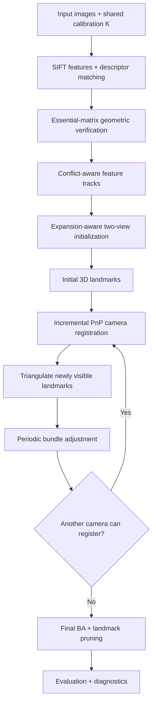

# Self-Diagnosing Incremental Structure-from-Motion

> **New to the project?** Start with
> [`PROJECT_GUIDE.md`](PROJECT_GUIDE.md). It explains the reconstruction
> from first principles, follows the runtime data flow, and gives the
> recommended code-reading order. The public README below is the
> repository reference; interview-specific study material belongs in
> `INTERVIEW_PREP_SFM.md`.

## Quick Mental Model

The pipeline starts with **2D-2D evidence** (feature matches), converts
it into **multi-view tracks**, triangulates some tracks into **3D
landmarks**, and then uses **2D-3D correspondences** to register
additional cameras with PnP. Each new camera can create more landmarks,
so the map expands incrementally. Bundle adjustment refines the joint
geometry, while typed diagnostics explain why expansion stops.

``` text
2D-2D matches -> verified tracks -> initial 3D map
                                      |
                                      v
                              2D-3D correspondences
                                      |
                                      v
                              PnP camera registration
                                      |
                                      v
                              new triangulated points
                                      |
                                      +---- repeat
```

### Implementation boundary

The project intentionally mixes custom geometry with established
solvers. Essential estimation/RANSAC, track construction, initialization
ranking, triangulation logic, reconstruction policy, BA problem
construction/gauge handling, diagnostics, and evaluation are project
implementations. OpenCV supplies SIFT and production PnP/refinement;
SciPy supplies nonlinear least squares for bundle adjustment; NumPy
supplies numerical primitives such as SVD.

## Pipeline



The final reconstruction is classified as `SUCCESS`, `PARTIAL`, or
`FAILED` with an explicit termination reason such as `COMPLETED`,
`NO_2D3D_BRIDGE`, or `NO_REGISTRABLE_CAMERA`.

## Why This Project Is Interesting

A geometrically strong two-view pair is not automatically a good seed
for incremental SfM. A pair may have strong parallax and many inliers
while being poorly connected to the rest of the image set.

The initializer therefore considers both:

-   **geometric quality** --- Essential-matrix support, cheirality,
    parallax, reprojection quality, and homography degeneracy;
-   **expansion support** --- whether the initial tracks can provide
    enough 2D↔3D correspondences to register additional cameras.

The project also treats reconstruction coverage as a first-class metric.
A small partial reconstruction can have a lower reprojection RMS than a
complete reconstruction, so RMS alone is not treated as evidence of
success.

## Representative Results

The following values are from the current canonical runs. Re-run the
commands below when validating a new code revision and update this table
if the metrics change.

  Dataset                         Registered cameras   Landmarks   Final RMS Status
  ----------------------------- -------------------- ----------- ----------- -----------
  Middlebury TempleRing                      47 / 47      14,471    0.391 px `SUCCESS`
  Middlebury TempleSparseRing                 4 / 16         655    0.238 px `PARTIAL`

TempleSparseRing is useful as a failure-analysis case: despite its lower
reprojection residual, only 4 of 16 cameras are registered and
reconstruction terminates with `NO_2D3D_BRIDGE`. This demonstrates why
reprojection RMS must be reported together with coverage and
connectivity.

## Ablation Results

Fresh TempleRing runs isolate the effect of two major pipeline
components:

  --------------------------------------------------------------------------------------
  Configuration      Cameras   Landmarks        RMS         Mean  Mean center    Runtime
                                                        rotation        error 
                                                           error              
  --------------- ---------- ----------- ---------- ------------ ------------ ----------
  Full pipeline      47 / 47      14,471    **0.391       0.266°        0.13%    414.5 s
                                               px**                  diameter 

  No bundle          47 / 47      14,684   8.591 px       0.633°        0.32%    **102.4
  adjustment                                                         diameter        s**

  No geometric       47 / 47      11,816   0.424 px   **0.193°**      **0.09%   1556.4 s
  verification                                                     diameter** 
  --------------------------------------------------------------------------------------

The ablations show different roles:

-   **Bundle adjustment** is expensive but critical for global geometric
    consistency: removing it preserves 47/47 camera coverage while
    increasing reprojection RMS from 0.391 px to 8.591 px.
-   **Pairwise geometric verification** is not required for camera
    coverage on TempleRing, but it substantially reduces the
    correspondence/track workload. Without it the run is much slower and
    reconstructs fewer landmarks, while pose error remains competitive.
    An ablation does not need to make every metric worse to demonstrate
    a component's value.

## Architecture

The code separates high-level SfM sequencing from geometry, numerical
optimization, typed reconstruction state, and experiment support.

``` text
main.py
  │
  ▼
src/sfm.py                     public API: run_sfm()
  │
  ▼
src/pipeline/orchestration.py  high-level stage sequencing
  │
  ├── verification.py         pairwise geometric verification
  ├── initialization_stage.py initial cameras + initial map
  ├── registration.py         incremental PnP registration
  └── finalization.py         final optimization + diagnostics
          │
          ├── reconstruction_ops.py
          ├── bundle.py
          └── diagnostics.py
```

Core numerical and domain modules:

  -----------------------------------------------------------------------
  Module                              Responsibility
  ----------------------------------- -----------------------------------
  `src/models.py`                     Canonical typed cameras,
                                      observations, tracks, landmarks,
                                      reconstruction, and state

  `src/geometry/essential.py`         Essential estimation, Sampson
                                      error, RANSAC, decomposition, and
                                      pose selection

  `src/geometry/projection.py`        Projection, normalization, camera
                                      centers, depth, and parallax
                                      geometry

  `src/geometry/pose.py`              Pose and alignment utilities

  `src/initialization.py`             Two-view evaluation and
                                      expansion-aware initial-pair
                                      ranking

  `src/tracks.py`                     Conflict-aware multi-view
                                      feature-track construction

  `src/triangulation.py`              Two-view / multi-view DLT and
                                      geometric validation

  `src/pnp.py`                        Production PnP registration and
                                      camera-quality gates

  `src/bundle_adjustment.py`          Joint nonlinear optimization of
                                      cameras and landmarks

  `src/validation/`                   Degeneracy checks and structured
                                      reconstruction diagnostics

  `src/evaluation.py`                 Sim(3) alignment and quantitative
                                      pose/reprojection evaluation

  `src/visualization.py`              Reconstruction plots, diagnostic
                                      figures, and PLY export

  `src/colmap_io.py`                  Optional COLMAP model reader for
                                      external calibrated scenes

  `src/colmap_export.py`              Optional export to COLMAP sparse
                                      text format
  -----------------------------------------------------------------------

### Coordinate Convention

All camera poses follow the world-to-camera convention:

``` text
X_camera = R @ X_world + t
C = -R.T @ t
x ~ K(RX + t)
```

where `C` is the camera center in world coordinates.

### Reconstruction State

`ReconstructionState` is the canonical state passed through the
incremental pipeline.

``` text
ReconstructionState
├── Reconstruction
│   ├── CameraIntrinsics
│   ├── RegisteredCamera
│   └── Landmark
├── TrackManager
├── keypoints
├── SfMConfig
├── diagnostics
└── runtime statistics
```

Numerical solvers may temporarily operate on NumPy arrays, but optimized
values are applied back to the typed reconstruction model rather than
maintaining a second mutable reconstruction representation.

## Implementation Boundaries

The project deliberately combines custom geometric reasoning with
established library components.

### Implemented in the Project

-   Hartley-normalized 8-point Essential matrix estimation
-   Sampson-error scoring and deterministic Essential RANSAC
-   Essential decomposition and cheirality-based pose selection
-   conflict-aware feature-track construction
-   expansion-aware initial-pair selection
-   multi-view DLT triangulation
-   depth, parallax, and reprojection validation
-   incremental reconstruction state and camera-selection logic
-   PnP acceptance / rejection quality gates
-   bundle-adjustment residual construction and gauge handling
-   landmark pruning
-   view-graph analysis and reconstruction diagnostics
-   Sim(3) alignment and quantitative evaluation

### Library-Assisted Components

-   **OpenCV**
    -   SIFT feature detection
    -   brute-force descriptor matching
    -   `solvePnPRansac`
    -   `solvePnPRefineLM`
    -   Rodrigues conversions
    -   homography estimation used as degeneracy evidence
-   **SciPy**
    -   nonlinear least-squares optimization
-   **NumPy**
    -   matrix algebra, SVD, and vectorized geometry
-   **Matplotlib**
    -   reconstruction and diagnostic figures

## Setup

Requires Python 3.13+ and [`uv`](https://docs.astral.sh/uv/).

``` powershell
uv sync
```

## Datasets

Benchmark data is intentionally not stored in the repository.

The project uses three local dataset directories:

``` text
data/
├── templeRing/
├── templeSparseRing/
└── truck/
```

-   **Middlebury TempleRing** --- primary complete reconstruction and
    quantitative evaluation dataset.
-   **Middlebury TempleSparseRing** --- sparse/wide-baseline case used
    to study connectivity limitations and structured
    partial-reconstruction diagnosis.
-   **Tanks & Temples Truck** --- optional larger-scene experiment
    prepared with images and a COLMAP reference/calibration model.

Other downloaded benchmark scenes are not required by the project.

## Running a Reconstruction

Primary demonstration dataset:

``` powershell
uv run python main.py --dataset templeRing
```

Wide-baseline / partial-reconstruction case:

``` powershell
uv run python main.py --dataset templeSparseRing
```

Optional larger scene:

``` powershell
uv run python main.py --dataset truck
```

Useful options:

  -----------------------------------------------------------------------
  Option                              Purpose
  ----------------------------------- -----------------------------------
  `--skip-ba`                         Disable bundle adjustment for an
                                      ablation

  `--skip-geometric-verification`     Disable Essential-matrix pair
                                      verification for an ablation

  `--no-cache`                        Recompute descriptor matches
                                      instead of loading the cached match
                                      graph

  `--output-label <label>`            Write to
                                      `output/<dataset>_<label>/`

  `--skip-colmap-export`              Disable optional COLMAP text-model
                                      export
  -----------------------------------------------------------------------

### Fresh validation runs

To reproduce the reported baseline, ablations, and diagnostic case
without using an existing match cache:

``` powershell
uv run python main.py --dataset templeRing --no-cache
uv run python main.py --dataset templeRing --no-cache --skip-ba --output-label no_ba
uv run python main.py --dataset templeRing --no-cache --skip-geometric-verification --output-label no_geom
uv run python main.py --dataset templeSparseRing --no-cache
```

## Tests

Run the regression suite:

``` powershell
uv run python -m tests.unit.test_initialization
uv run python -m tests.synthetic.run_all
uv run python tests/integration/test_pipeline.py
```

The synthetic suite covers core geometry and reconstruction invariants,
including Essential geometry, triangulation, PnP pose recovery, bundle
adjustment, gauge constraints, degeneracies, and disconnected view
graphs.

## Outputs

Each run writes artifacts under:

``` text
output/<dataset>/
```

Depending on the dataset and whether reference poses are available:

  -----------------------------------------------------------------------
  Artifact                            Purpose
  ----------------------------------- -----------------------------------
  `reconstruction.json`               Intrinsics, registered camera
                                      poses, landmarks, and
                                      reconstruction status

  `diagnostics.json`                  Diagnostic events, camera statuses,
                                      rejection counts, and termination
                                      reason

  `metrics.json`                      Machine-readable quantitative
                                      evaluation when reference poses are
                                      available

  `metrics.txt`                       Human-readable evaluation summary

  `pointcloud.ply`                    Colored sparse point cloud

  `matches_init_pair.png`             Verified correspondences for the
                                      selected initialization pair

  `reconstruction_3d.png`             Sparse reconstruction and camera
                                      visualization

  `camera_ring.png`                   Estimated vs. reference camera
                                      trajectory

  `reproj_hist.png`                   Reprojection-error distribution

  `ba_history.png`                    Bundle-adjustment RMS history

  `pose_error_by_registration.png`    Pose error by camera registration
                                      order

  `colmap/`                           Optional COLMAP-compatible sparse
                                      text model and registered images
  -----------------------------------------------------------------------

## Current Limitations

The current implementation assumes:

-   one known shared intrinsic matrix `K`;
-   an ideal pinhole camera or pre-undistorted images;
-   a static scene;
-   sufficient feature overlap between views;
-   sparse reconstruction rather than dense multi-view stereo.

Exhaustive pair matching scales quadratically with image count, and
repeated global bundle adjustment becomes increasingly expensive on
larger datasets.
