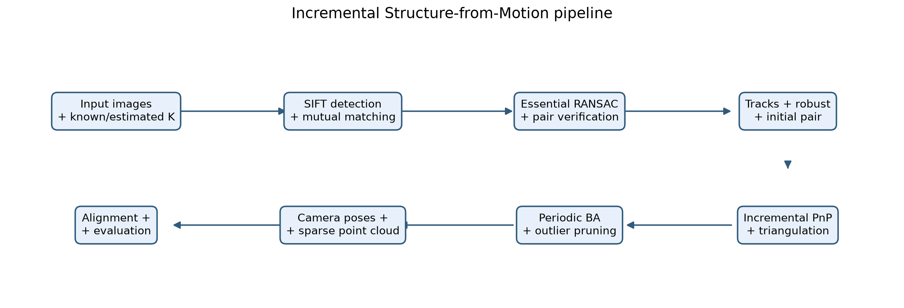
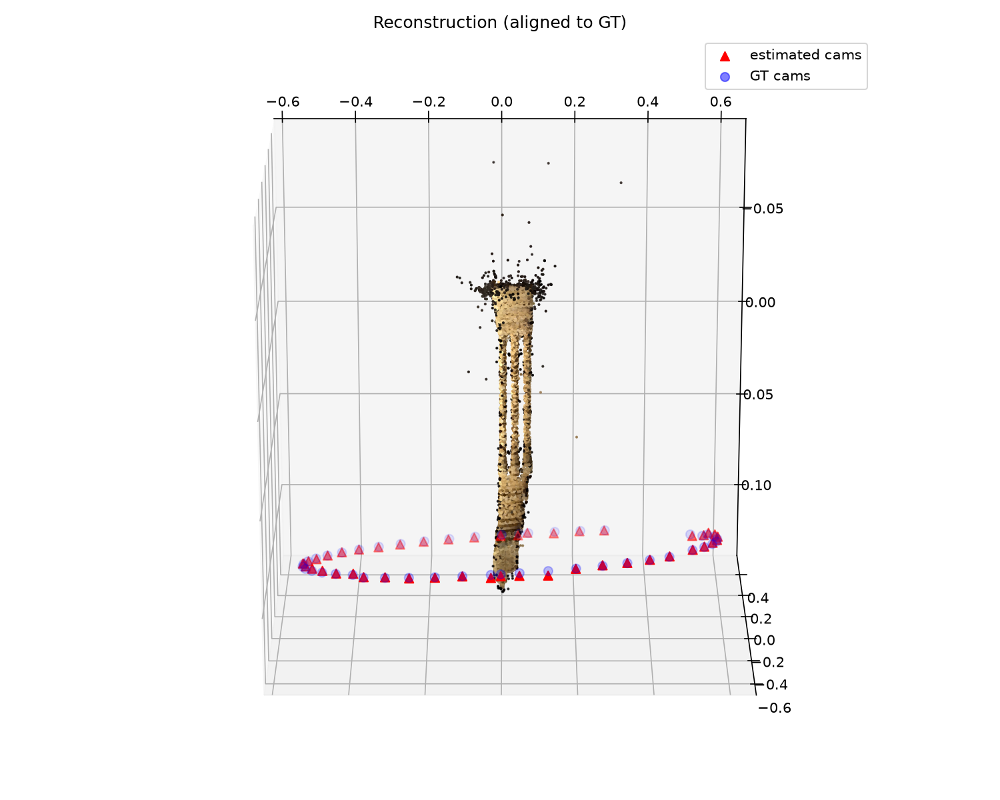
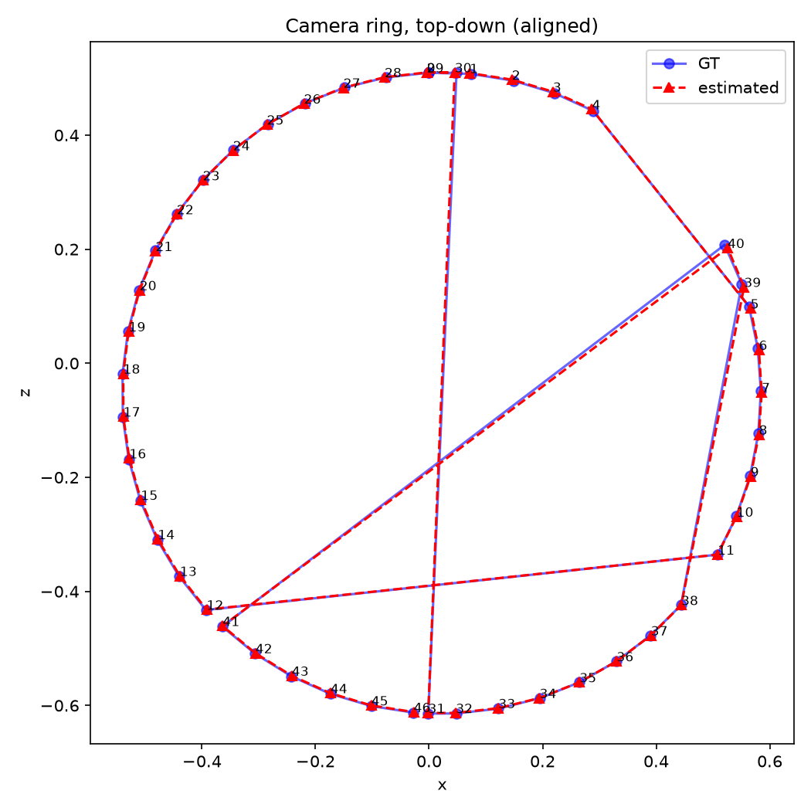
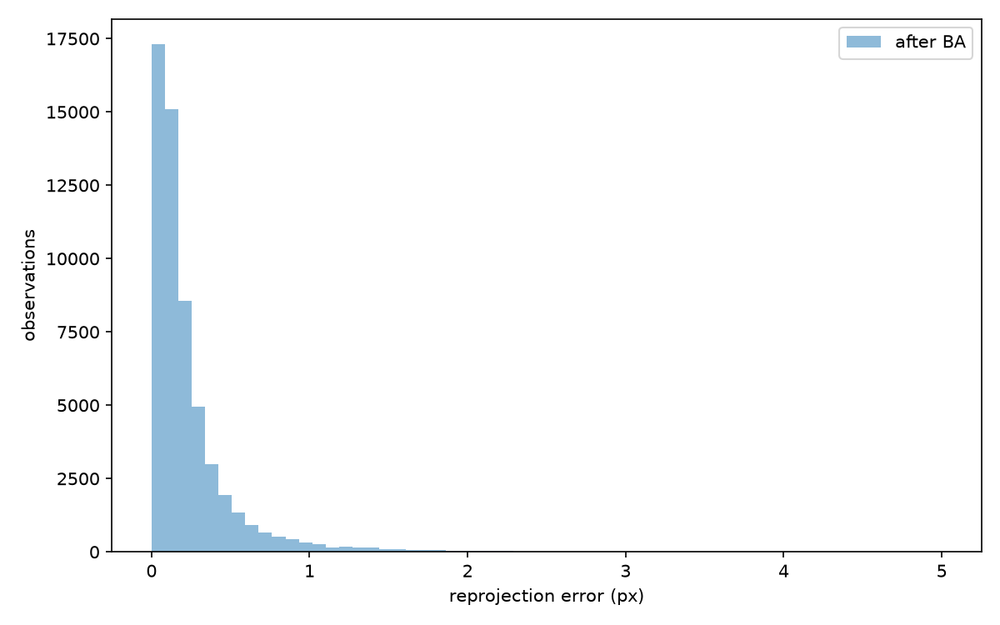
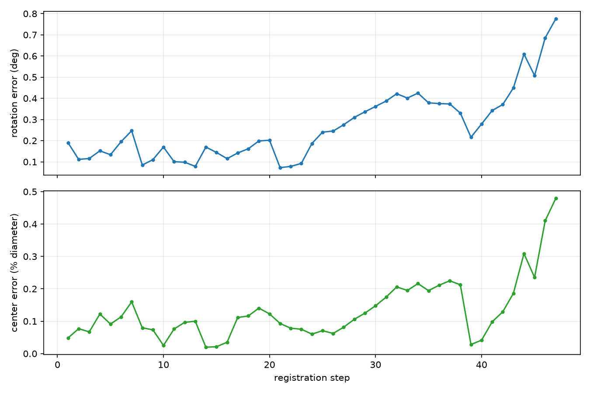
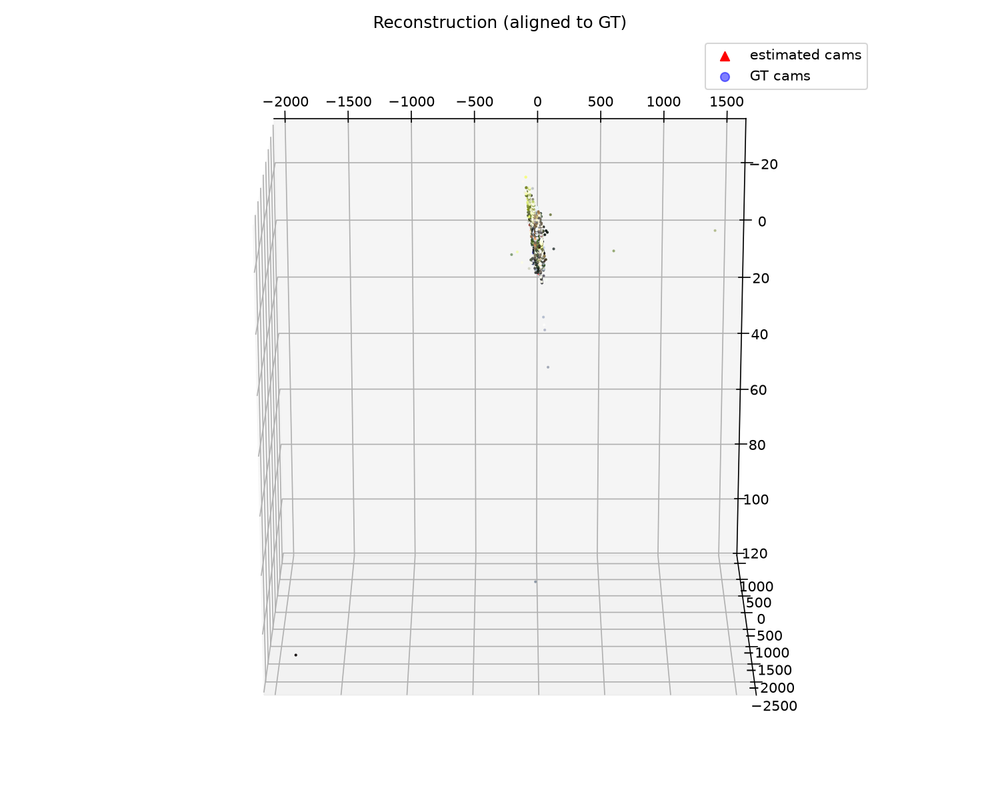
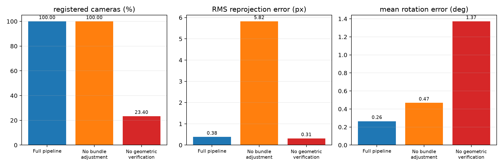
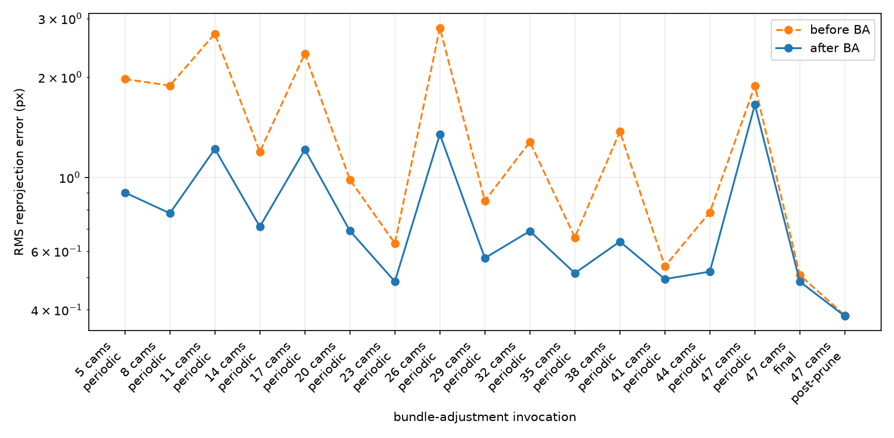
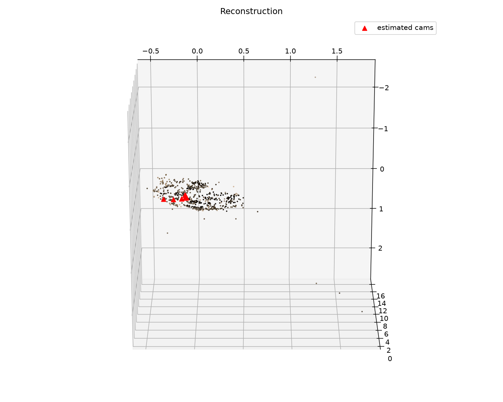

# Incremental Structure-from-Motion from Scratch

**3D Computer Vision — Final Project**  
Ron Keter

## 1. Introduction

Structure-from-Motion (SfM) recovers camera poses and sparse 3D scene structure
from overlapping images. It combines many of the central topics in 3D computer
vision: local features, robust epipolar geometry, triangulation, camera
resectioning, and nonlinear optimization.

This project implements a complete **incremental SfM pipeline from scratch**.
The normalized 8-point essential-matrix estimator, RANSAC, cheirality-based pose
recovery, multi-view DLT triangulation, conditioned DLT PnP, local nonlinear PnP
refinement, track management, outlier filtering, bundle adjustment, alignment,
and evaluation are implemented in NumPy and SciPy. OpenCV is used only for SIFT
feature detection and descriptor matching.

The project makes four experimental contributions:

1. quantitative evaluation against the calibrated Middlebury *TempleRing*
   cameras;
2. controlled ablations of geometric verification and bundle adjustment;
3. a larger-scene generalization experiment on Tanks & Temples *Truck*; and
4. analysis of two realistic failure regimes: a sparse wide-baseline ring and a
   self-captured motorcycle-helmet video.

The full pipeline registers all 47 TempleRing images, reconstructs 13,811 3D
points, and reaches 0.383 px RMS reprojection error, 0.265° mean rotation error,
and 0.130% mean camera-center error relative to the full trajectory diameter.

## 2. Method

### 2.1 Features, matching, and verification

SIFT detects up to 8,000 keypoints per image with a permissive contrast
threshold for the low-texture temple images. Descriptors are matched with
brute-force L2 distance, Lowe's ratio test (0.8), and a mutual-consistency
check. Because the Middlebury filename order is not a reliable view-adjacency
signal, every image pair is considered.

Appearance matching alone is unsafe on the repeated temple colonnade. Each
candidate pair is therefore verified independently with essential-matrix
RANSAC before tracks are built. A pair survives only when at least 30 matches
agree with one epipolar geometry. On TempleRing this reduces 115,833 raw
matches to 70,358 verified matches and 350 candidate pairs to 153 verified
pairs.

### 2.2 Two-view geometry

Intrinsics **K** are assumed known. Pixel observations are converted to
normalized camera coordinates, and the essential matrix is estimated with the
8-point algorithm. Hartley normalization conditions both point sets before
solving the homogeneous linear system by SVD. The result is projected onto the
essential-matrix singular-value constraint `(1, 1, 0)`.

RANSAC draws minimal 8-point samples and scores them with squared Sampson
distance. The threshold is derived from a 3 px tolerance and the focal length,
avoiding a resolution-dependent fixed normalized threshold. The final model is
refit on all inliers.

Essential-matrix decomposition produces four `(R, t)` candidates. A cheirality
test triangulates the inliers and selects the pose that places the most points
in front of both cameras.

### 2.3 Tracks and triangulation

Feature tracks are connected components over `(image, keypoint)` observations,
built with union-find from verified pairwise matches. A component containing
two distinct keypoints from one image is discarded as inconsistent.

New 3D points are estimated with multi-view DLT: each observing camera
contributes two homogeneous equations, and the solution is the final right
singular vector. Points are rejected if they have negative depth, exceed 4 px
reprojection error in any observing image, or have less than 1° triangulation
angle.

### 2.4 Incremental registration

Initialization considers well-supported verified pairs and chooses the pair
with the largest median triangulation angle. This favors a well-conditioned
baseline rather than simply selecting the pair with the most matches.

Each subsequent image is selected by the number of correspondences to existing
3D tracks. Its pose is estimated by a conditioned 6-point DLT inside PnP
RANSAC. Both 2D and 3D coordinates are normalized, followed by local nonlinear
pose refinement and inlier recounting. Acceptance considers both absolute
support and inlier ratio so that a small but nearly unanimous correspondence
set can still register a thin-overlap view.

After registration, all newly visible tracks are triangulated. Failed images
are deferred and retried after the map grows.

### 2.5 Bundle adjustment

Bundle adjustment jointly minimizes the squared reprojection residuals over
camera poses and 3D points:

$$
\min_{\{R_i,t_i\},\{X_j\}}
\sum_{(i,j)\in\mathcal{O}}
\left\|\pi\!\left(K(R_iX_j+t_i)\right)-x_{ij}\right\|^2.
$$

Camera rotations use Rodrigues axis-angle parameters. The first camera is held
fixed to remove the global gauge freedom. `scipy.optimize.least_squares` uses
an explicit sparse Jacobian structure: each residual depends only on one
camera's six parameters and one point's three coordinates. BA runs after every
three registered views and at the end. High-error points are then removed and
a final post-pruning BA is performed.

## 3. Experimental protocol

### 3.1 Datasets

- **Middlebury TempleRing:** 47 calibrated 640×480 views sampled around a
  plaster temple. Its supplied camera matrices provide the primary ground-truth
  pose evaluation.
- **Middlebury TempleSparseRing:** 16 calibrated views of the same object with
  approximately three times the angular spacing. It is used as a controlled
  wide-baseline failure case.
- **Tanks & Temples Truck:** 84 frames obtained by taking every third image from
  a 251-image sequence. Intrinsics and camera poses come from the distributed
  COLMAP reconstruction. Consequently, its pose errors measure agreement with
  a strong external SfM reference, not independent ground truth.
- **Self-captured helmet video:** 70 sharp frames selected from equal temporal
  windows of a 4K phone video. Intrinsics are approximated from the EXIF
  35mm-equivalent focal length; no reference poses are available.

Synthetic scenes with exact cameras and points separately validate Rodrigues
conversion, essential estimation and pose selection, triangulation, PnP, and
bundle adjustment.

### 3.2 Metrics

Estimated camera centers are aligned to the reference frame with a similarity
transform using Umeyama alignment. Camera-center error is normalized by the
diameter of the **full input reference trajectory**, so incomplete and complete
runs use the same scale. Rotation error is the geodesic angle between aligned
estimated and reference rotations.

Registration completeness is always reported alongside reprojection error.
This is essential because a small, locally consistent partial reconstruction
can achieve low residual error while failing to recover most of the scene.

### 3.3 Ablations

Three TempleRing configurations use identical features and cached raw matches:

1. the full pipeline;
2. no bundle adjustment; and
3. no pairwise geometric verification, with BA still enabled.

This isolates optimization accuracy from correspondence-graph robustness.

## 4. Results

### 4.1 TempleRing accuracy

| Metric | Full pipeline |
|---|---:|
| Registered cameras | **47 / 47 (100%)** |
| 3D points | 13,811 |
| Observations | 56,601 |
| Mean track length | 4.10 |
| RMS reprojection error | **0.383 px** |
| Mean / median / 90th-percentile rotation error | **0.265° / 0.216° / 0.434°** |
| Maximum rotation error | 0.776° |
| Mean camera-center error | **0.130% of trajectory diameter** |
| Total runtime | 364.5 s (6.1 min) |

*Estimated cameras and sparse structure after similarity alignment to the
Middlebury calibration.*

*Top-down trajectory comparison. The estimated loop follows all 47 reference
cameras.*

*Final observation residuals concentrate below one pixel.*

*Pose error in the order cameras enter the reconstruction. The largest errors
are localized rather than growing monotonically along the full sequence.*

### 4.2 Cross-dataset behavior

| Dataset | Pose reference | Registered | Points | RMS (px) | Mean / max rotation | Mean center error | Runtime |
|---|---|---:|---:|---:|---:|---:|---:|
| TempleRing | Middlebury calibration | **47/47** | 13,811 | **0.383** | **0.265° / 0.776°** | **0.130%** | 6.1 min |
| Truck | COLMAP estimate | **84/84** | 49,641 | **0.520** | **0.055° / 0.172°** | **0.024%** | 4.28 h |
| TempleSparseRing | Middlebury calibration | **3/16** | 208 | 0.280 | 10.351° / 10.397° | — | — |

The Truck experiment shows that the pipeline can register a substantially
larger real sequence and closely reproduce external COLMAP camera estimates.
It also exposes the present scalability limitation: exhaustive pair matching
and repeated global BA increase runtime from minutes to 4.28 hours.

TempleSparseRing fails after three cameras because its approximately 22° view
spacing provides too little reliable SIFT overlap. Its 0.280 px RMS is lower
than the successful TempleRing result, yet its rotation error is about 10.35°
and 81% of cameras are missing. This is direct evidence that reprojection error
alone is not a reconstruction-quality metric.

### 4.3 Ablation study

| Configuration | Registered | Points | RMS (px) | Mean rotation error |
|---|---:|---:|---:|---:|
| Full pipeline | **47/47** | 13,811 | **0.383** | **0.265°** |
| No bundle adjustment | 47/47 | 13,931 | 5.822 | 0.468° |
| No geometric verification | **11/47** | 2,270 | 0.314 | 1.372° |

Without BA, local PnP remains strong enough to register every view, but the
final reprojection RMS is 15.2 times larger and mean rotation error is 1.8
times larger. BA therefore improves both image-space consistency and metric
pose accuracy rather than merely producing a cosmetically cleaner point cloud.

Without pairwise geometric verification, false appearance matches merge
unrelated observations into contaminated tracks. The pipeline stalls at 11
cameras even though BA drives the surviving submodel to 0.314 px RMS. This is
the most important robustness result: geometric verification determines global
completeness, while a low residual only certifies the small model that survived.

Across 17 BA invocations in the full run, every call reduces reprojection RMS;
the median reduction factor is 1.51×. Periodic optimization limits accumulated
drift before later cameras use the existing map for PnP.

### 4.4 Self-captured helmet

The helmet video registered 22/70 frames and reconstructed 636 sparse points
before stalling.

This sequence combines several departures from the calibrated benchmarks:
approximate EXIF intrinsics, ignored radial distortion, motion blur, view-
dependent highlights, and broad low-texture helmet surfaces. The partial result
is retained as a qualitative robustness case rather than presented as a
successful full reconstruction. It motivates better calibration and a capture
path with slower motion and more overlap.

## 5. Discussion

Three conclusions emerge from the experiments:

1. **Correspondence quality governs completeness.** RANSAC verification before
   track construction prevents a small number of repeated-structure matches
   from corrupting many later PnP correspondences.
2. **Optimization governs accuracy.** The no-BA run remains complete but has
   much larger residual and pose errors. Periodic BA keeps the incremental map
   accurate enough for later registration.
3. **Residual error must be interpreted with coverage.** Both the no-
   verification and TempleSparseRing failures have deceptively low final RMS
   because they optimize only small partial reconstructions.

Current limitations are the assumption of known shared intrinsics, omission of
radial distortion, exhaustive `O(n²)` image matching, and an incremental
strategy that can accumulate drift on long chains. Natural extensions within
the SfM scope are shared focal-length and radial-distortion refinement in BA,
sequence-aware matching with explicit loop closure, and global rotation
averaging. The existing COLMAP text exporter is retained only as a standard
interoperability and inspection format.

## 6. Conclusion

The project implements and evaluates an end-to-end incremental SfM system from
first principles. It recovers all TempleRing cameras with sub-pixel residuals
and sub-degree pose error, reproduces a larger Truck reference trajectory, and
uses controlled ablations and failure cases to distinguish local fit from
global reconstruction quality. The results demonstrate that robust geometric
verification and bundle adjustment play complementary roles: the former makes
the reconstruction complete, while the latter makes it accurate.

## References

1. R. Hartley and A. Zisserman. *Multiple View Geometry in Computer Vision*,
   2nd ed., Cambridge University Press, 2004.
2. S. Seitz, B. Curless, J. Diebel, D. Scharstein, and R. Szeliski. “A
   Comparison and Evaluation of Multi-View Stereo Reconstruction Algorithms.”
   CVPR, 2006.
3. J. L. Schönberger and J.-M. Frahm. “Structure-from-Motion Revisited.” CVPR,
   2016.
4. O. Chum, J. Matas, and J. Kittler. “Locally Optimized RANSAC.” DAGM, 2003.
5. S. Umeyama. “Least-Squares Estimation of Transformation Parameters Between
   Two Point Patterns.” IEEE TPAMI, 1991.
